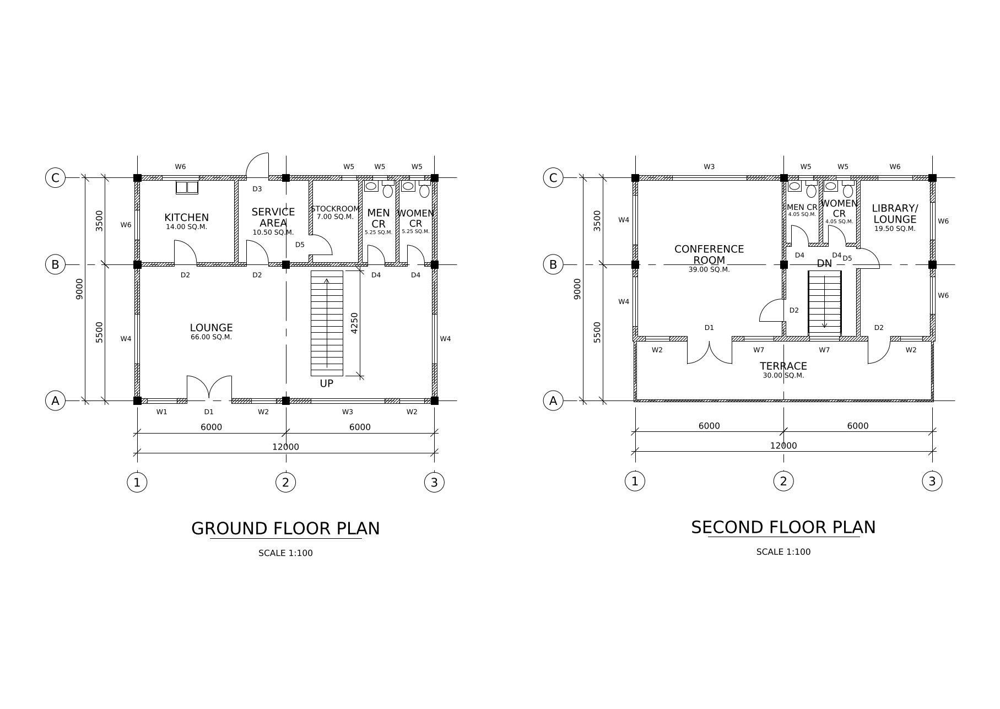

# autocad-ai-assisted

Describe a building's floor plans in a short text file, and get a real AutoCAD drawing:
walls, doors, windows, grids, dimensions, room areas and one A3 sheet per floor.
Claude can write and change those plan files for you, through the MCP server included
here, and then check the result as a picture.



## Can Claude draw in AutoCAD through Autodesk's own MCP server?

**Not yet.** As of November 2026, Autodesk's official AutoCAD MCP server works only
with Autodesk Assistant (the AI panel inside AutoCAD), and in plain AutoCAD it can
read and analyse a drawing but not draw new geometry. So this project creates the
drawing itself, as a DXF file that AutoCAD opens directly. Autodesk's server is still
useful for checking the result. The details, the two Autodesk servers you *can* connect
to Claude today, and the sources are in
**[docs/autodesk-mcp-guide.md](docs/autodesk-mcp-guide.md)**.

## How it works

```text
 plans/my-building.yaml ──► autocad-ai build ──► output/my-building/my-building.dxf ──► AutoCAD (SAVEAS .dwg)
   (walls, doors, rooms)        (Python)            + PNG previews of every sheet
          ▲                                                   │
          └──── Claude, through the MCP tools cad_* ◄─────────┘  (Claude looks at the previews)
```

- **Plan file (YAML)**: design intent in plain words: a wall from here to there, a 900 mm
  door 1 m from its start, a room called KITCHEN. See
  [the format](src/autocad_ai/plan_format.md).
- **Builder (Python, using the `ezdxf` library)**: turns the plan into a DXF with standard
  layers (`A-WALL`, `A-DOOR`, `A-GLAZ`, `A-GRID`, `A-ANNO-DIMS`...), real blocks for
  doors, windows and plumbing fixtures, 1:100 dimensions and A3 sheets with title blocks.
- **MCP server**: gives Claude Desktop or Claude Code nine tools: list, read, save, check,
  build, preview, inspect any DXF, and open in AutoCAD.

## Quick start on Windows (about 15 minutes)

You need Windows 10 or 11 with AutoCAD (or AutoCAD LT) to look at the result. Python and
Git are free. Run the commands in **PowerShell** (Start menu → type `PowerShell`).

### Phase 1: install the tools

1. **Install Python 3.12 or newer.** In PowerShell run:
   ```bash
   winget install Python.Python.3.13
   ```
   Close and reopen PowerShell, then check with `py --version`. You should see
   `Python 3.13.x`. (Alternative: the installer from python.org; tick
   *"Add python.exe to PATH"*.)
2. **Install Git** (it downloads the project):
   ```bash
   winget install Git.Git
   ```
   Reopen PowerShell. `git --version` should print a version number.

### Phase 2: get the project and install it

3. Download the project into your user folder:
   ```bash
   cd $HOME
   ```
   ```bash
   git clone https://github.com/AutoGenSystems/autocad-ai-assisted.git
   ```
   ```bash
   cd autocad-ai-assisted
   ```
4. Create a **virtual environment**, a private Python folder just for this project, so
   its libraries cannot clash with anything else on your PC:
   ```bash
   py -m venv .venv
   ```
5. Turn it on:
   ```bash
   .\.venv\Scripts\Activate.ps1
   ```
   Your prompt now starts with `(.venv)`. If PowerShell says running scripts is
   disabled, run `Set-ExecutionPolicy -Scope CurrentUser RemoteSigned`, answer `Y`, and
   repeat this step. That setting allows scripts you created locally to run.
6. Install the project and its libraries:
   ```bash
   pip install -e ".[dev]"
   ```
7. Check that it works:
   ```bash
   pytest
   ```
   The last line should say `28 passed`.

### Phase 3: build the demo and open it in AutoCAD

8. Build the demo plan:
   ```bash
   autocad-ai build plans\demo-commercial-building.yaml
   ```
   It prints what it drew (doors, windows, room areas...) and where the files are.
9. Open `output\demo-commercial-building\demo-commercial-building.dxf` in AutoCAD
   (**Open**, set the file type to **DXF**, or double-click the file).
10. Check the result: the **Model** tab shows both floors; the layout tabs
    **A-101 GROUND FLOOR PLAN** and **A-102 SECOND FLOOR PLAN** show the A3 sheets.
11. To keep it as a normal drawing, type `SAVEAS` and choose **AutoCAD Drawing (\*.dwg)**.

No AutoCAD at hand? Look at the pictures in `docs/images/`, or open
`examples/demo-commercial-building.dxf` in Autodesk's free viewer, DWG TrueView.

## Use it from Claude

**Claude Code.** Claude Code can simply run `autocad-ai build ...` in this folder. To
give it the MCP tools as well, run this once from the project folder (with the
virtual environment active), replacing `C:\Users\YOU` with your real user folder:

```bash
claude mcp add --env AUTOCAD_AI_WORKSPACE=C:\Users\YOU\autocad-ai-assisted --transport stdio autocad-ai -- C:\Users\YOU\autocad-ai-assisted\.venv\Scripts\autocad-ai-mcp.exe
```

Check with `claude mcp list`. It should show `autocad-ai` as `✔ Connected`.

**Claude Desktop.**

1. Open Claude Desktop's **Settings** (on Windows: the ☰ menu at the top left →
   **File** → **Settings**), go to **Developer**, and click **Edit Config**.
2. Put this in the file, replacing `YOU` with your Windows user name (keep the double
   backslashes):
   ```json
   {
     "mcpServers": {
       "autocad-ai": {
         "command": "C:\\Users\\YOU\\autocad-ai-assisted\\.venv\\Scripts\\autocad-ai-mcp.exe",
         "args": [],
         "env": { "AUTOCAD_AI_WORKSPACE": "C:\\Users\\YOU\\autocad-ai-assisted" }
       }
     }
   }
   ```
   If the file already has other servers, add `"autocad-ai": {...}` inside the
   existing `mcpServers` instead of replacing the whole file.
3. Save, then **quit Claude Desktop completely** (also from the system tray) and start
   it again.
4. Check: in a chat, click **+** (bottom left) → **Connectors**. `autocad-ai` should be
   listed with its `cad_*` tools. If not, read
   `%APPDATA%\Claude\logs\mcp-server-autocad-ai.log`.

**Things to ask Claude**

- *"Read the plan format, then make a plan for a 10 m by 8 m one-storey shop with a sales
  area, an office and one CR, and build it."*
- *"Show me the ground floor sheet."* Claude calls `cad_preview_drawing` and sees the image.
- *"Move the kitchen door 500 mm towards the stair and rebuild."*
- *"Open it in AutoCAD."*
- *"Inspect C:\Drawings\reference.dxf and list its layers and blocks."*

Claude asks before it uses each tool. `cad_save_plan` refuses to overwrite a plan unless
you say so.

## The sample project you shared

The sample (a two-storey commercial building) is only **partly** rebuilt so far. Its room
list and sheet list were read from the DWG files, but the exact wall and door geometry
could not be decoded in the cloud sandbox. `plans/demo-commercial-building.yaml` therefore
uses the real rooms in an **assumed layout**, and says so in every title block. To finish
it, a DXF or PDF export of the drawing is needed; see
**[docs/sample-project-notes.md](docs/sample-project-notes.md)**.

## Repository layout

```text
plans/                         plan files (YAML); start with demo-commercial-building.yaml
src/autocad_ai/
  plan.py                      plan format: fields, validation, design checks
  geometry.py                  wall outlines: clean junctions, door/window gaps (shapely)
  builder.py                   DXF drawing: layers, blocks, dimensions, grids, sheets (ezdxf)
  preview.py                   PNG previews of model space and sheets
  inspect_drawing.py           summary of any DXF (or DWG via ODA File Converter)
  pipeline.py                  build DXF + previews + report in one call
  mcp_server.py                the MCP server (9 tools) for Claude
  cli.py                       the autocad-ai command
  plan_format.md               plan format reference (also served to Claude)
tests/                         28 automated tests (pytest)
docs/                          Autodesk MCP guide, sample-project notes, preview images
examples/                      the demo drawing, ready to open in AutoCAD
```

## Limitations (version 0.1)

- Floor plans only: no elevations, sections, foundation or roof framing plans yet.
- Straight walls. A small built-in library of doors, windows, WC, lavatory, kitchen
  sink and urinal.
- Output is DXF (AutoCAD 2013 format). Use SAVEAS in AutoCAD for DWG.
- The drawings pass `ezdxf`'s structural audit, but they have not yet been opened in
  AutoCAD itself during development. Please report anything that looks wrong.
- The checks are geometric (does a door fit its wall?), not building-code checks. A
  licensed architect or engineer must still review real projects.
- Previews use a substitute font, so text looks slightly wider than in AutoCAD (Arial).
